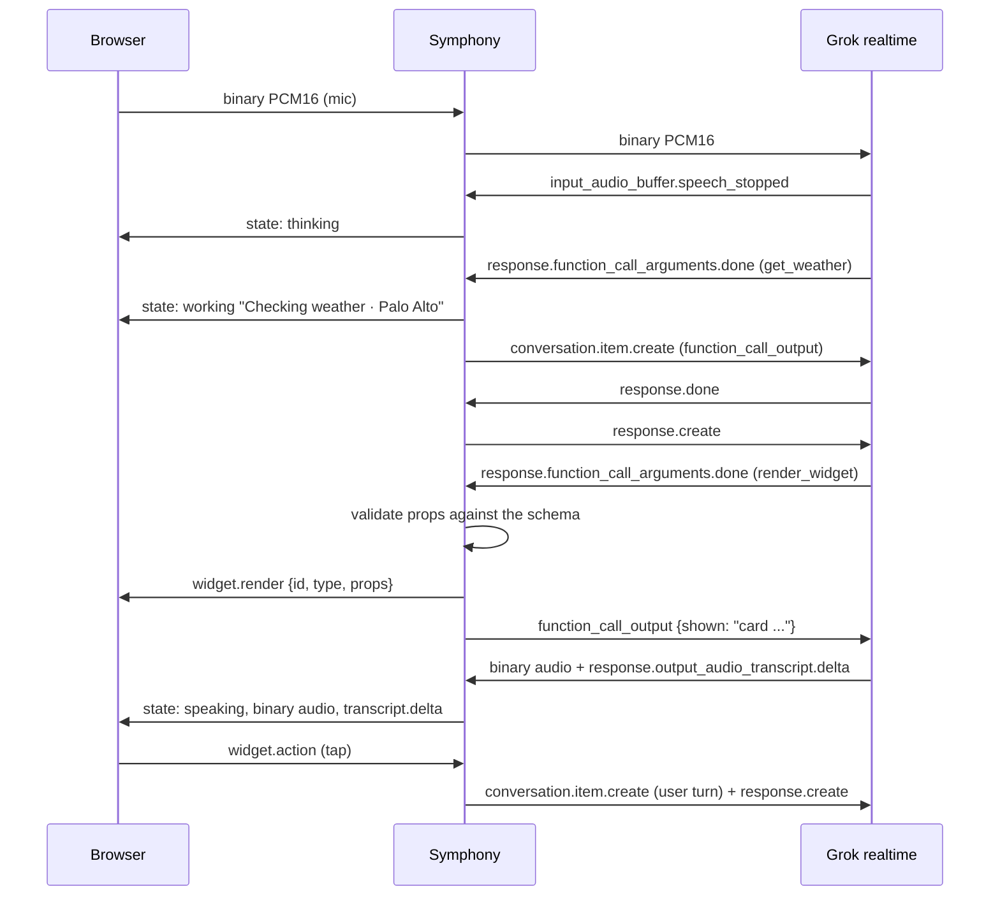

<p align="center">
  
</p>

# Osmo

**Building a Muse with a durable harness and a first-class chat SDK that speaks its protocol**

Osmo brings together <a href="https://github.com/Sarthakischauhan/symphony">Symphony</a>, a durable harness for agents, and the <a href="https://github.com/Sarthakischauhan/chat-sdk">Chat SDK</a>, designed to speak the harness protocol. The aim is a Muse: an assistant that can listen, reason, use tools, and respond through voice and an interactive canvas.

## How it works

The browser captures speech and streams audio to the session endpoint. Symphony owns the agent turn: it connects to the model, handles model events, runs tools, validates widget payloads, and emits protocol events. The chat SDK consumes those events to render conversation content and interactive widgets. Audio playback and the visual conversation stay synchronized as one session.

### One turn



The protocol is the boundary between the harness and the experience. Symphony is responsible for reliably coordinating work; the SDK is responsible for making that work legible and actionable. This separation lets the interface evolve without owning agent execution, and lets the harness serve a first-class UI without dictating its presentation.

## What Osmo is exploring

- **Voice-native interaction:** speech is the primary input and spoken responses are part of the session, not an add-on to a text chat.
- **A durable agent harness:** model turns, tool execution, and state transitions belong to Symphony rather than the UI.
- **Protocol-driven UI:** messages, activity, and widgets are structured events the SDK can render and act on.
- **An extensible model boundary:** the harness should be able to support different model providers while keeping the client-facing protocol stable.

## Project boundaries

| Part | Responsibility |
| --- | --- |
| [Symphony](https://github.com/Sarthakischauhan/symphony) | Durable agent execution, session coordination, and tools. |
| [Chat SDK](https://github.com/Sarthakischauhan/chat-sdk) | Protocol-aware conversation UI, message rendering, and interactive widgets. |
| Osmo client | Voice capture and playback, orb state, and composition of the SDK experience. |

## Provider keys: file or Infisical

Provider keys entered in "Connect provider" live only on the server, behind a `SecretStore`
(`apps/symphony-server/src/symphony_server/secret_store.py`). `OSMO_SECRET_STORE` picks one:

- `file` (default, for local use): one Fernet-encrypted file, `OSMO_CREDENTIALS_FILE`
  (default `~/.config/osmo/credentials.enc`), with the key from `OSMO_CREDENTIALS_KEY` or, when that is
  unset, a key generated once into `<OSMO_CREDENTIALS_FILE>.key` (mode 0600).
- `infisical`: an [Infisical](https://infisical.com) project, through the official Python SDK
  (`infisicalsdk`) with machine-identity universal auth.

The API never returns a key: `GET /providers` reports only whether each provider is connected, and
no key is ever logged.

### Infisical setup

1. Create a project in Infisical (Secrets Management) and note its project ID (Project Settings) and
   the environment slug to use, for example `prod`.
2. Create a machine identity: Organization > Access Control > Machine Identities > Create. Universal
   Auth is configured by default; under it, select Add Client Secret and copy the Client ID and Client Secret.
3. Add the identity to the project (Project > Access Control > Machine Identities > Add Machine
   Identity to Project) with a role that can read, create, edit and delete secrets and folders under `/osmo`.
4. Run the server with:

   | Variable | Value |
   | --- | --- |
   | `OSMO_SECRET_STORE` | `infisical` |
   | `INFISICAL_CLIENT_ID` | the identity's Client ID |
   | `INFISICAL_CLIENT_SECRET` | its Client Secret |
   | `INFISICAL_PROJECT_ID` | the project ID |
   | `INFISICAL_ENV` | the environment slug, e.g. `prod` |
   | `INFISICAL_CACHE_TTL_S` | optional; seconds to cache reads, default `60` |
   | `INFISICAL_SITE_URL` | optional; default `https://app.infisical.com` (EU cloud: `https://eu.infisical.com`, or your self-hosted URL) |

The server logs in on first use and tracks the token's lifetime (`expiresIn`): it logs in again
60 seconds (or 10% of the lifetime, if shorter) before the token expires, and if Infisical still
answers 401 it logs in again and retries the call once; a second failure returns 502. No restart is
needed when tokens expire, but the Client Secret itself must stay valid (TTL 0 means it never expires).

Each owner's credentials are cached in memory for `INFISICAL_CACHE_TTL_S` seconds (default 60),
and the cache is dropped on every connect or disconnect. A key changed directly in Infisical shows
up within that window.

### Folder layout

Each credential is a folder `/osmo/<owner>/<provider>` holding one secret, `KEY`, whose comment is the
auth kind (`api_key` or `oauth`); for example `/osmo/default/openrouter/KEY`. The owner is always
`default` today; it is a parameter of the store so per-user keys can come later. The folders are
created on first use, and disconnecting a provider deletes its folder.

## Desktop voice assistant and computer support

Osmo also runs in Electron with the same voice UI and opt-in primary-screen inspection, mouse,
keyboard and scroll tools. Run `make install`, `make build`, then `bun run desktop`. Computer support
requires PyAutoGUI and a connected vision model. See [desktop setup and packaging](apps/desktop/README.md)
for the complete setup, OS permissions, shortcuts and current distribution limits.

## Contributing

## Development

Install Bun and [uv](https://docs.astral.sh/uv/), then from the repository root:

```sh
make install
```

For live voice sessions, add an xAI key in the app's Providers panel (it is validated, then kept in the server's secret store; the `XAI_API_KEY` environment variable is not read). Optional server settings: `OSMO_TOOLS` (comma-separated tool categories: `search`, `image`, `osmo`; all by default), `EXA_API_KEY` (lifts Exa's shared rate limit for web search), `OSMO_IMAGE_MODEL` (core_ai image model, default `grok:grok-imagine-image-2.0`), `XAI_BASE_URL`.

Voice and agent: the voice model keeps the quick tools and hands longer work to a background agent with `run_agent` (it returns a run id at once; `agent_status` and `cancel_agent` follow it). The agent's progress comes back into the voice session as notices, and talking over Osmo stops its speech, never the run. Agent steps in `OSMO_APPROVAL_TOOLS` (comma-separated tool names, default `create_image`) wait for Approve / Deny in the app (`POST /api/approvals/{id}`). `OSMO_AGENT_MODEL` picks the agent's core_ai model (default `grok:grok-4.7`).

Persistence: threads, messages, agent runs and provider connections are kept in SQLite at `OSMO_DATABASE_FILE` (in memory when unset). The REST API is `GET/POST /api/threads`, `GET/PATCH/DELETE /api/threads/{id}`, and `POST /api/threads/{id}/fork`.

Provider sign-in: OpenRouter uses its documented PKCE key exchange. Vercel uses Sign in with Vercel (OAuth authorization code + PKCE) once an app is registered: set `OSMO_VERCEL_OAUTH_CLIENT_ID` and `OSMO_VERCEL_OAUTH_CLIENT_SECRET`, with callback `{origin}/providers/vercel/oauth/callback` and scopes `openid offline_access`. Without them Vercel, and xAI, OpenAI and Gemini, take an API key (none of them documents a third-party OAuth flow that gives Realtime or inference access Osmo can use).

Run the web client and Python server in separate terminals with `make dev-web` and `make dev-server`. Use `make typecheck`, `make test`, and `make build` for frontend checks and production build; `make server-check` and `make server-test` run Python checks. See [CONTRIBUTING.md](CONTRIBUTING.md) for details.
