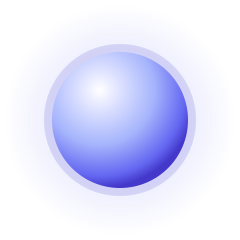
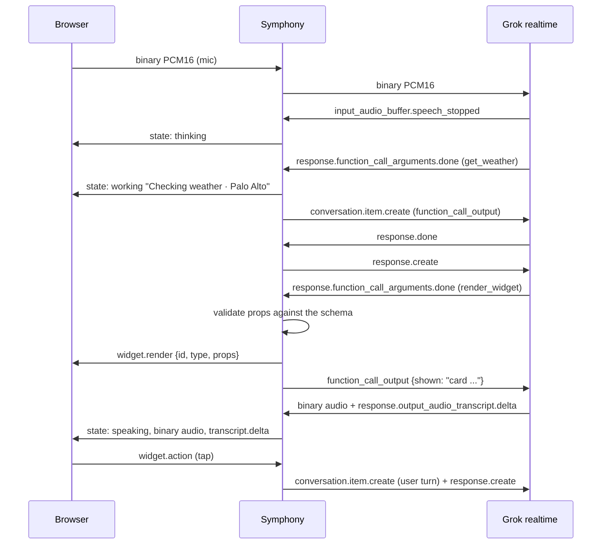

<p align="center">
  
</p>

# Osmo

**Building a Muse with a durable harness and a first-class chat SDK that speaks its protocol**

Osmo brings together <a href="https://github.com/Sarthakischauhan/symphony">Symphony</a>, a durable harness for agents, and the <a href="https://github.com/Sarthakischauhan/chat-sdk">Chat SDK</a>, designed to speak the harness protocol. The aim is a Muse: an assistant that can listen, reason, use tools, and respond through voice and an interactive canvas.

## How it works

The browser captures speech and streams audio to the session endpoint. Symphony owns the agent turn: it connects to the model, handles model events, runs tools, validates widget payloads, and emits protocol events. The chat SDK consumes those events to render conversation content and interactive widgets. Audio playback and the visual conversation stay synchronized as one session.

### One turn



The protocol is the boundary between the harness and the experience. Symphony is responsible for reliably coordinating work; the SDK is responsible for making that work legible and actionable. This separation lets the interface evolve without owning agent execution, and lets the harness serve a first-class UI without dictating its presentation.

## What Osmo is exploring

- **Voice-native interaction:** speech is the primary input and spoken responses are part of the session, not an add-on to a text chat.
- **A durable agent harness:** model turns, tool execution, and state transitions belong to Symphony rather than the UI.
- **Protocol-driven UI:** messages, activity, and widgets are structured events the SDK can render and act on.
- **An extensible model boundary:** the harness should be able to support different model providers while keeping the client-facing protocol stable.

## Project boundaries

| Part | Responsibility |
| --- | --- |
| [Symphony](https://github.com/Sarthakischauhan/symphony) | Durable agent execution, session coordination, and tools. |
| [Chat SDK](https://github.com/Sarthakischauhan/chat-sdk) | Protocol-aware conversation UI, message rendering, and interactive widgets. |
| Osmo client | Voice capture and playback, orb state, and composition of the SDK experience. |

## Contributing

## Development

Install Bun and [uv](https://docs.astral.sh/uv/), then from the repository root:

```sh
make install
```

Set `XAI_API_KEY` in your environment for live voice sessions. Run the web client and Python server in separate terminals with `make dev-web` and `make dev-server`. Use `make typecheck`, `make test`, and `make build` for frontend checks and production build; `make server-check` and `make server-test` run Python checks. See [CONTRIBUTING.md](CONTRIBUTING.md) for details.
