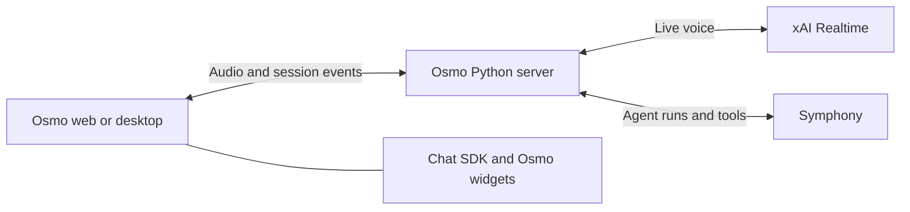

<p align="center">
  
</p>

# Osmo

**A voice-first AI assistant that can talk, show its work, and help you act.**

Talk to Osmo naturally. It can respond out loud, bring results into an interactive canvas, and hand longer tasks to a background agent while you keep the conversation going. Use it in the browser, or run the desktop app for an always-on-top orb and opt-in computer support.

The idea is a **Muse**: an assistant you can think with and work alongside—not just a text box you send prompts to.

[Run locally](#run-locally) · [Desktop setup](apps/desktop/README.md) · [Configuration](docs/configuration.md) · [Contributing](CONTRIBUTING.md)

## What you can do

- **Have a live voice conversation.** Speak, hear responses, and interrupt Osmo when you want to take the conversation somewhere else.
- **See more than a transcript.** Interactive widgets put results and actions alongside the conversation, rather than leaving everything in spoken answers.
- **Keep talking while work runs.** A background agent handles web search and, when enabled, browser tasks. Follow its progress, approve requested actions, or cancel the run.
- **Work with a visible browser.** The optional browser widget streams the agent's page and lets you take over by clicking, scrolling, and typing in fullscreen.
- **Get help on your desktop.** With explicit opt-in, the Electron app can inspect your primary screen and use mouse, keyboard, and scroll tools.
- **Return to a thread.** Create, reopen, rename, fork, and delete conversations. Configure a SQLite file to keep history across server restarts.

**Current scope:** live voice uses xAI's Realtime API. Other connected providers can serve supported agent, image, and vision models; they are not interchangeable voice backends. Desktop support requires OS permissions and a connected vision model. See the [desktop guide](apps/desktop/README.md) for platform and packaging limits.

## Run locally

You need [Bun](https://bun.sh/), [uv](https://docs.astral.sh/uv/), and an xAI API key for live voice. The install target creates a Python 3.12 environment through uv.

```sh
git clone https://github.com/Sarthakischauhan/osmo.git
cd osmo
make install
```

Start the server and web client in separate terminals:

```sh
# Terminal 1
make dev-server
```

```sh
# Terminal 2
make dev-web
```

Open **http://localhost:5173**, connect xAI in the app's **Providers** panel, and start a voice session with the orb. Keys are stored server-side; setting `XAI_API_KEY` in your shell does not connect the provider.

The server listens on `127.0.0.1:8787`. The web development server proxies requests to it.

### Desktop

The Electron app uses the same voice experience, with a compact orb window and optional computer support. Start with the [desktop setup guide](apps/desktop/README.md) for dependencies, launch commands, permissions, and stop controls.

### Configuration and safety

- **Credentials:** the default secret store is a local Fernet-encrypted file. Infisical is also supported.
- **Persistence:** set `OSMO_DATABASE_FILE` to a SQLite file path to retain threads and runs across restarts. Without it, the database is in memory.
- **Browser tools:** opt in with `OSMO_TOOLS` and `OSMO_BROWSER_PATH`. Agent clicks and typing require approval by default.
- **Computer support:** requires native consent. It can send real input to your desktop; it does not enforce a separate approval dialog for every action. Review the [controls and limits](apps/desktop/README.md#use) before enabling it.

See [configuration](docs/configuration.md) for provider storage, Infisical setup, model selection, browser lifecycle, approvals, and tracing.

## How it fits together

Osmo is the assistant experience built around two reusable projects:

| Layer | Role |
| --- | --- |
| [Symphony](https://github.com/Sarthakischauhan/symphony) | Agent execution, tool orchestration, and structured events. |
| [Chat SDK](https://github.com/Sarthakischauhan/chat-sdk) | Conversation rendering and protocol-driven interactive UI. |
| Osmo | Voice capture and playback, the orb, widgets, and the web and desktop apps. |

The client captures speech and streams it to Osmo's Python server. The server connects to xAI Realtime for voice, coordinates tool calls and background agents, and sends audio, transcripts, activity, and widget events back to the client.



The boundary is deliberate: agent execution stays on the server; the client turns structured events into a conversation you can hear, see, and interact with. The current voice connection is xAI-specific, while the agent and UI layers remain separate.

## Development

After `make install`:

```sh
make typecheck     # TypeScript checks
make test          # Frontend tests
make build         # Production web build
make server-check  # Python type checks
make server-test   # Python tests
```

Tests use mocked providers and do not require API keys. See [CONTRIBUTING.md](CONTRIBUTING.md) for the development workflow and architecture notes.
