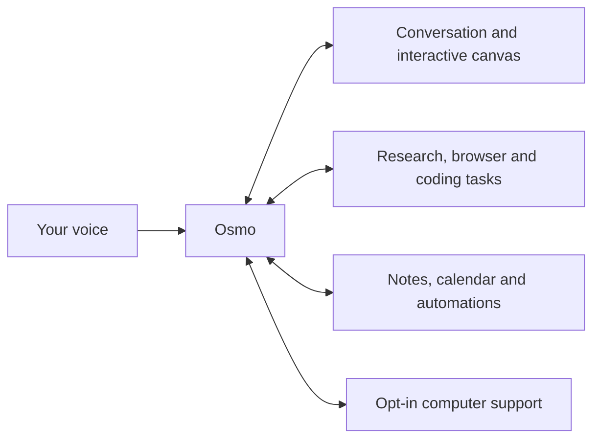

  

<h1 align="center">Osmo</h1>

<strong>Think out loud. Put ideas to work.</strong>

A voice-first AI assistant for your conversations, research, notes, and everyday tasks. Talk naturally, see results on an interactive canvas, and keep going while Osmo works in the background.

  <a href="docs/getting-started.md"><strong>Get started</strong></a> ·
  <a href="apps/desktop/README.md">Desktop app</a> ·
  <a href="docs/configuration.md">Configuration</a> ·
  <a href="CONTRIBUTING.md">Contribute</a>

## An assistant to think with—and work alongside

Osmo is building toward a **Muse**: an assistant that feels like part of your workspace, not another prompt box. Start with a conversation. Turn it into research, a note, a scheduled task, or a change to your code. Hear the answer when that is enough; open the canvas when you need to see and interact with the work.

### Speak naturally. Keep your train of thought.

Have a live voice conversation and interrupt when you want to change direction. Osmo pairs spoken answers with transcripts and interactive widgets, so useful results do not disappear when the audio ends.

### Delegate the work, not the conversation.

Send research and browser tasks to a background agent while you keep talking. Follow progress in Tasks, review actions that need approval, or take over the browser yourself. Recoverable runs resume after a server restart rather than silently losing their place.

### Bring your day into the same workspace.

Search and edit local Markdown notes. Keep events in a calendar and schedule automations that start a task, send a notification, or append to a note. Play local music—or connect Spotify in the desktop app—with playback that quiets down while Osmo speaks.

### Go from a request to a pull request.

On macOS, the coding agent can work in its own repository workspace, make changes, and propose a pull request for your approval. Describe the change you want without leaving the conversation.

### Stay close, without taking over your screen.

Use Osmo in the browser or as a desktop app with a compact, always-on-top orb. When you explicitly enable computer support, it can inspect your primary screen and help with mouse and keyboard actions. You stay in control of when that access starts and stops.

## Try a conversation

> “Research this topic while we talk through the options.”
>
> “Find my notes about the launch and help me draft the next steps.”
>
> “Open a PR on owner/repo that fixes the typo in the README.”
>
> “Look at my screen and help me find the browser settings.”

Available actions depend on the providers and optional tools you connect. Computer support requires native consent and a vision model; coding tools currently require macOS. Spotify playback requires Premium and desktop setup.

## One workspace, several ways to work

## Get started

Osmo currently runs from source. You will need **Bun**, **uv**, and a provider connection; an **xAI API key** is the default path for live voice.

**[Run Osmo locally →](docs/getting-started.md)**

Install dependencies, start the web app and server, and connect your provider.

**[Set up the desktop app →](apps/desktop/README.md)**

Launch the orb, configure computer support, and review OS permissions and packaging limits.

## Built on Symphony and Chat SDK

[Symphony](https://github.com/Sarthakischauhan/symphony) powers agent execution and tools. [Chat SDK](https://github.com/Sarthakischauhan/chat-sdk) brings the conversation and interactive UI together. Osmo makes them a voice-first workspace.

For the implementation rather than the tour:

- [Architecture](docs/architecture.md) — packages, session flow, and execution boundaries.
- [Configuration](docs/configuration.md) — providers, storage, tools, approvals, and integrations.
- [Contributing](CONTRIBUTING.md) — development setup and checks.

**Before enabling tools:** browser actions, coding tasks, and computer support can affect real websites, repositories, and your desktop. Review [approvals and browser controls](docs/configuration.md#approvals-and-status) and [desktop controls and limits](apps/desktop/README.md#use). Approval prompts do not undo actions already taken.
