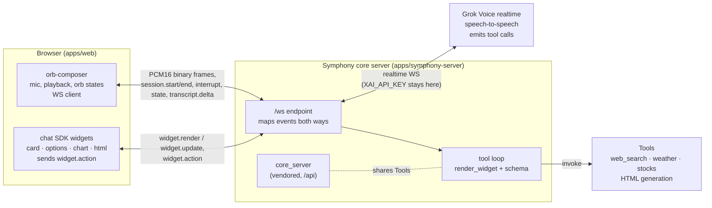
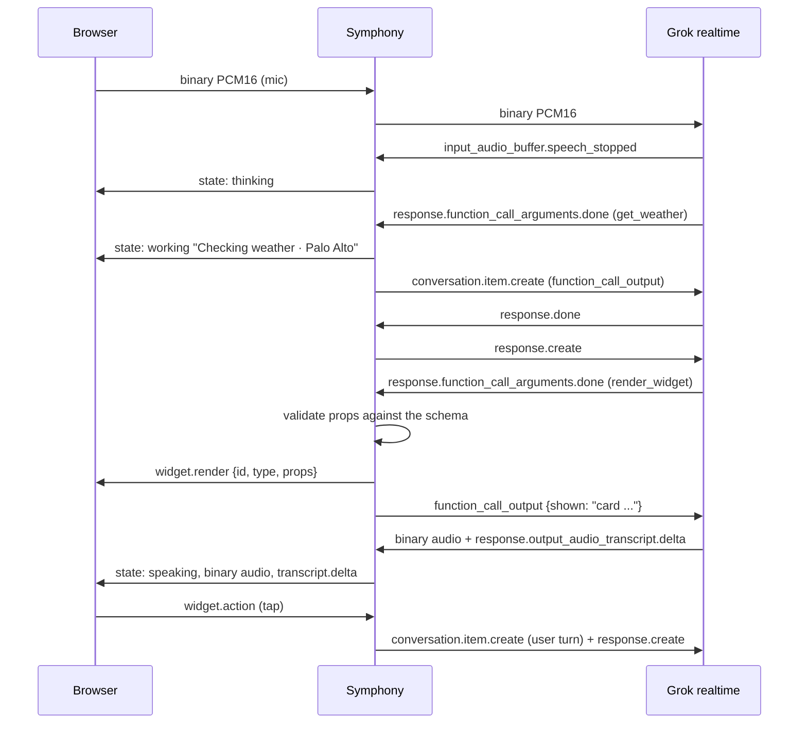

# osmo

Symphony as a harness and my chat SDK voice product.

## Orb

Orb is a voice-only assistant. You talk to the orb. Symphony thinks and runs tools, and the answers come back as speech plus live widgets (cards, options, charts, sandboxed HTML). Voice is the only input. Widgets are the only visual output besides the orb.



### One turn



### Layout

| Path | Owns |
| --- | --- |
| `apps/symphony-server` | Python FastAPI app. Mounts `core_server`'s run API at `/api` and adds `/ws`. Owns the Grok realtime session, the tool loop, `render_widget`/`update_widget`, and prop validation. |
| `vendor/core_server` | Symphony's `core_server`, vendored **unmodified** from [symphony@a335957](https://github.com/Sarthakischauhan/symphony/tree/a335957c53009d6c4f82e8176a9abf975b736979/core_server) until it is published. See `vendor/README.md`. |
| `packages/orb-composer` | Orb UI, mic capture and playback, WS client, wire protocol types. No chat SDK imports. |
| `packages/chat-sdk-widgets` | Widget registry, the 4 renderers and the `widget.action` callback. |
| `apps/web` | Full-screen page: orb at the bottom, widget canvas above. |

### Wire protocol (browser ↔ Symphony)

One WebSocket at `/ws`. Binary frames are PCM16 audio, 24 kHz mono, little-endian. Text frames are JSON:

| Direction | Event | Payload |
| --- | --- | --- |
| client → server | binary | mic audio |
| client → server | `session.start` / `session.end` | `voice?`, `instructions?` |
| client → server | `interrupt` | — |
| client → server | `widget.action` | `id`, `action`, `value?` |
| server → client | binary | assistant audio |
| server → client | `state` | `state` (idle, listening, thinking, speaking, working), `detail?` (`barge-in` = flush playback) |
| server → client | `transcript.delta` | `role`, `text` |
| server → client | `widget.render` | `widget: {id, type, props}` |
| server → client | `widget.update` | `id`, `patch` |

The browser never sees the Grok key or Grok's event format. Symphony speaks the xAI realtime events documented at <https://docs.x.ai/docs/guides/voice/agent> and <https://docs.x.ai/developers/rest-api-reference/inference/voice>.

### Run locally

```sh
# server (Python 3.11+, uv)
cd apps/symphony-server
uv venv -p 3.12 .venv && uv pip install --no-sources -p .venv -r requirements.txt
XAI_API_KEY=... .venv/bin/python -m symphony_server      # :8787

# web
pnpm install && pnpm dev:web                              # :5173, proxies /ws to :8787
```

`--no-sources` is needed because the vendored `core_server` keeps its upstream uv-workspace sources unmodified.

### Test

```sh
pnpm typecheck && pnpm test                               # TS packages + web
cd apps/symphony-server && .venv/bin/mypy && .venv/bin/python -m pytest -q
```

The server tests run against a local fake Grok websocket server and mocked HTTP. They need no network and no key.

### Deploy

`Dockerfile` builds one container in which symphony-server serves the built web app and `/ws` on `$PORT`. Set `XAI_API_KEY` as a runtime secret on the host. It is never baked into the image.

```sh
docker build -t orb . && docker run -p 8080:8080 -e XAI_API_KEY=... orb
```
