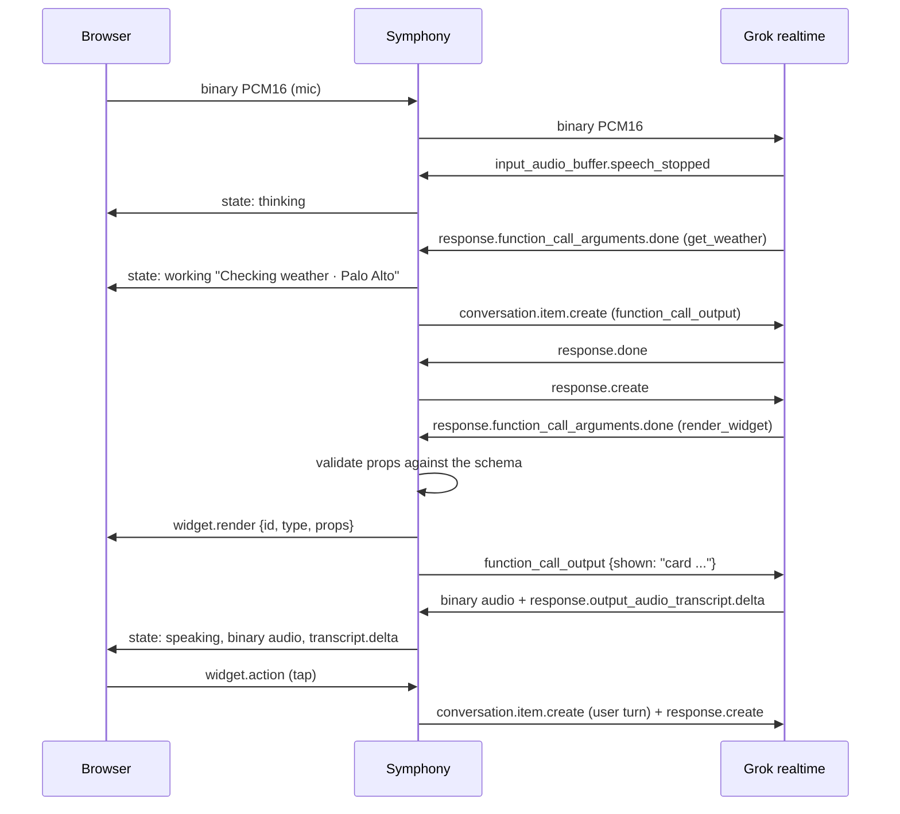

<p align="center">
  
</p>

# Osmo

**Building a Muse with a durable harness and a first-class chat SDK that speaks its protocol**

Osmo brings together <a href="https://github.com/Sarthakischauhan/symphony">Symphony</a>, a durable harness for agents, and the <a href="https://github.com/Sarthakischauhan/chat-sdk">Chat SDK</a>, designed to speak the harness protocol. The aim is a Muse: an assistant that can listen, reason, use tools, and respond through voice and an interactive canvas.

## How it works

The browser captures speech and streams audio to the session endpoint. Symphony owns the agent turn: it connects to the model, handles model events, runs tools, validates widget payloads, and emits protocol events. The chat SDK consumes those events to render conversation content and interactive widgets. Audio playback and the visual conversation stay synchronized as one session.

### One turn



The protocol is the boundary between the harness and the experience. Symphony is responsible for reliably coordinating work; the SDK is responsible for making that work legible and actionable. This separation lets the interface evolve without owning agent execution, and lets the harness serve a first-class UI without dictating its presentation.

## What Osmo is exploring

- **Voice-native interaction:** speech is the primary input and spoken responses are part of the session, not an add-on to a text chat.
- **A durable agent harness:** model turns, tool execution, and state transitions belong to Symphony rather than the UI.
- **Protocol-driven UI:** messages, activity, and widgets are structured events the SDK can render and act on.
- **An extensible model boundary:** the harness should be able to support different model providers while keeping the client-facing protocol stable.

## Project boundaries

| Part | Responsibility |
| --- | --- |
| [Symphony](https://github.com/Sarthakischauhan/symphony) | Durable agent execution, session coordination, and tools. |
| [Chat SDK](https://github.com/Sarthakischauhan/chat-sdk) | Protocol-aware conversation UI, message rendering, and interactive widgets. |
| Osmo client | Voice capture and playback, orb state, and composition of the SDK experience. |

## Provider keys: file or Infisical

Provider keys entered in "Connect provider" live only on the server, behind a `SecretStore`
(`apps/symphony-server/src/symphony_server/secret_store.py`). `OSMO_SECRET_STORE` picks one:

- `file` (default, for local use): one Fernet-encrypted file, `OSMO_CREDENTIALS_FILE`
  (default `~/.config/osmo/credentials.enc`), with the key from `OSMO_CREDENTIALS_KEY` or, when that is
  unset, a key generated once into `<OSMO_CREDENTIALS_FILE>.key` (mode 0600).
- `infisical`: an [Infisical](https://infisical.com) project, through the official Python SDK
  (`infisicalsdk`) with machine-identity universal auth.

The API never returns a key: `GET /providers` reports only whether each provider is connected, and
no key is ever logged.

### Infisical setup

1. Create a project in Infisical (Secrets Management) and note its project ID (Project Settings) and
   the environment slug to use, for example `prod`.
2. Create a machine identity: Organization > Access Control > Machine Identities > Create. Universal
   Auth is configured by default; under it, select Add Client Secret and copy the Client ID and Client Secret.
3. Add the identity to the project (Project > Access Control > Machine Identities > Add Machine
   Identity to Project) with a role that can read, create, edit and delete secrets and folders under `/osmo`.
4. Run the server with:

   | Variable | Value |
   | --- | --- |
   | `OSMO_SECRET_STORE` | `infisical` |
   | `INFISICAL_CLIENT_ID` | the identity's Client ID |
   | `INFISICAL_CLIENT_SECRET` | its Client Secret |
   | `INFISICAL_PROJECT_ID` | the project ID |
   | `INFISICAL_ENV` | the environment slug, e.g. `prod` |
   | `INFISICAL_CACHE_TTL_S` | optional; seconds to cache reads, default `60` |
   | `INFISICAL_SITE_URL` | optional; default `https://app.infisical.com` (EU cloud: `https://eu.infisical.com`, or your self-hosted URL) |

The server logs in on first use and tracks the token's lifetime (`expiresIn`): it logs in again
60 seconds (or 10% of the lifetime, if shorter) before the token expires, and if Infisical still
answers 401 it logs in again and retries the call once; a second failure returns 502. No restart is
needed when tokens expire, but the Client Secret itself must stay valid (TTL 0 means it never expires).

Each owner's credentials are cached in memory for `INFISICAL_CACHE_TTL_S` seconds (default 60),
and the cache is dropped on every connect or disconnect. A key changed directly in Infisical shows
up within that window.

### Folder layout

Each credential is a folder `/osmo/<owner>/<provider>` holding one secret, `KEY`, whose comment is the
auth kind (`api_key` or `oauth`); for example `/osmo/default/openrouter/KEY`. The owner is always
`default` today; it is a parameter of the store so per-user keys can come later. The folders are
created on first use, and disconnecting a provider deletes its folder.

## Desktop voice assistant and computer support

Osmo also runs in Electron with the same voice UI and opt-in primary-screen inspection, mouse,
keyboard and scroll tools. Run `make install`, `make build`, then `bun run desktop`. Computer support
requires PyAutoGUI and a connected vision model. See [desktop setup and packaging](apps/desktop/README.md)
for the complete setup, OS permissions, shortcuts and current distribution limits.

## Contributing

## Development

Install Bun and [uv](https://docs.astral.sh/uv/), then from the repository root:

```sh
make install
```

For live voice sessions, add an xAI key in the app's Providers panel (it is validated, then kept in the server's secret store; the `XAI_API_KEY` environment variable is not read). Optional server settings: `OSMO_TOOLS` (comma-separated tool categories: `search`, `image`, `osmo`, `browser`, `desktop`, `code`; everything except `browser` and `desktop` by default), `EXA_API_KEY` (lifts Exa's shared rate limit for web search), `LANGFUSE_PUBLIC_KEY` and `LANGFUSE_SECRET_KEY` (optional; trace each spoken turn to Langfuse, with `LANGFUSE_BASE_URL` for a non-EU host), `OSMO_IMAGE_MODEL` (core_ai image model, default `grok:grok-imagine-image-2.0`), `XAI_BASE_URL`.

Voice and agent: the voice model keeps widgets, voice changes and computer support, and hands web search to a background agent with `run_agent` (it returns a run id at once; `agent_status` and `cancel_agent` follow it). The agent has `web_search`, and, when `OSMO_TOOLS` includes `browser` and a Chromium browser is found (or `OSMO_BROWSER_PATH` points at one), `browser_open`, `browser_read`, `browser_click`, `browser_type` and `browser_scroll`: each Osmo session (thread) gets one Chrome, headless unless `OSMO_BROWSER_VISIBLE=1` (driven over CDP, in its own process group), shown live in an agent browser widget. It outlives the runs that use it: later runs reuse the same page, the widget keeps streaming between runs and is put back when a client reconnects, and it closes on the widget's Close button, after 30 minutes without use (a tool call, your input in fullscreen, opening the thread, or a run ending) unless a run is still using it, when the session ends (if a run is still going, that run finishes in the background first, its result stored with the thread like every run's, and the browser closes after it; a new session on the thread before then keeps it), or when the server shuts down (the server also reaps Chrome processes a killed server left behind when it starts). In the widget's fullscreen mode you can click, scroll and type into the page yourself (your own input needs no approval; the agent's `browser_click` and `browser_type` still do). The agent also has `browser_back`, `browser_forward`, `browser_press` (one named key; it waits for approval like a click), `browser_select` (a dropdown option) and `browser_wait` (up to 10 s for text to appear). Without `OSMO_BROWSER_PATH` Osmo uses the first Chromium browser it finds (Google Chrome, Chromium, Edge or Brave: the macOS app bundles, then PATH). `OSMO_BROWSER_PROFILE=1` gives the browser Osmo's own persistent profile (`~/.config/osmo/browser-profile`, or a folder you name), so sites you log in to stay logged in; it is never your everyday Chrome profile, and while one thread's browser has it, others get a throwaway profile. `OSMO_BROWSER_VISIBLE=1` opens a real Chrome window as well as streaming it. The model never sees what is typed into fields: `browser_read` lists controls without their values, marks password, one-time-code and card fields `sensitive`, and `browser_type` refuses those, so logins and payments are yours: press **Take over** on the widget (it opens fullscreen and stops every agent browser tool until **Hand back**). `OSMO_BROWSER_RULES` sets per-site rules, e.g. `github.com=allow,news.example=ask,bank.example=deny`: `allow` lets clicks, typing and key presses through without asking, `ask` always asks for them, `deny` keeps the agent off the site (it cannot open it, a redirect there is left at once, and on such a page every browser tool refuses); a rule covers subdomains, `*.site` only subdomains, the longest pattern wins, and the widget's readout shows Trusted or Blocked. The voice model is told when the agent needs approval, is done or failed (and each of these interrupts it); the agent's current step only appears in the widget and in `agent_status`'s `phase`. Talking over Osmo stops its speech, never the run: the app cuts the voice off itself the moment it hears you (150 ms of speech, no wait for the server, whose audio can be seconds ahead), tells the server to interrupt, and sends what you started saying. While Osmo speaks, an echo guard keeps its own voice out of the microphone stream so it never interrupts itself: frames are held back and only count as you when they are loud on their own and next to what Osmo is playing (packages/osmo-composer/src/echoGuard.ts). Agent steps named in `OSMO_APPROVAL_TOOLS` (comma-separated tool names; `browser_click`, `browser_type`, `browser_press`, `open_pull_request`, `vault_write` and `automation_create` by default) wait for Approve / Deny in the app (`POST /api/approvals/{id}`). `OSMO_AGENT_MODEL` picks the agent's core_ai model (default `grok:grok-4.7`).

Durable runs: agent runs survive a restart. Each run's submission, events, and conversation (checkpointed after every model turn) are written to `runs.db` next to `OSMO_DATABASE_FILE` as they happen. When the server stops mid-run (crash, kill, upgrade), the next start resumes the run on the same run id and session, with a note telling the agent to check its work before continuing. The run's card shows "Resumed after Osmo restarted". A run that keeps taking the server down is given up after three restarts; one the user cancelled is not resumed. Finished runs are kept for 30 days.

Coding agent (the `code` category, macOS only): the agent can clone a repository (`owner/name`, an https git URL, or a local repo path) into its own workspace under `OSMO_WORKSPACES_DIR` (default `~/.config/osmo/workspaces`, one directory per run, reused when the run resumes), work on it with `shell`, `read_file`, `write_file` and `edit_file`, and open a pull request with `open_pull_request`. Everything it runs goes through a Seatbelt sandbox (`sandbox-exec`): it can only write its workspace, cannot read your home directory (only toolchains like `~/.cargo` and `~/.bun`), cannot reach the keychain, AppleEvents or LaunchServices, and gets a clean environment with no credentials. Network stays on for package installs. Only the clone and the push run outside the sandbox. To publish, the sandbox exports a `git bundle`, and the host pushes it from a pristine clone the sandbox cannot write. Git config or hooks planted in the workspace never run with your credentials. Pushing uses your `gh` login, and the pull request waits for your Approve. `OSMO_AGENT_MAX_TURNS` (default 60) bounds one run. Try: "open a PR on owner/repo that fixes the typo in the README".

Persistence: threads, messages, agent runs and provider connections are kept in SQLite at `OSMO_DATABASE_FILE` (default `~/.config/osmo/osmo.db`). The REST API is `GET/POST /api/threads`, `GET/PATCH/DELETE /api/threads/{id}`, and `POST /api/threads/{id}/fork`. Records survive a restart. Durable unfinished runs are resumed when possible; runs that cannot be recovered are marked failed and can be started again. Connecting a provider unlocks only the capabilities shown for it: xAI provides the default voice, agent, and image path, while other providers may provide text, voice, or vision only.

Notes (vaults): `OSMO_VAULTS` lists markdown folders as `name=path` pairs (comma-separated; default one vault `notes` at `~/Osmo/Notes`, created on start; empty turns notes off). The server keeps an SQLite FTS5 index of them at `OSMO_VAULT_INDEX_FILE` (default `~/.config/osmo/vault-index.db`), brought up to date by mtime on start and kept fresh by a file watcher, so edits from Obsidian or any editor show up. The voice model and the agent both get `vault_search`, `vault_read` and `vault_write` (the `vault` tool category); `vault_write` is in the default `OSMO_APPROVAL_TOOLS`, so every write by either one waits for Approve / Deny (voice tool calls are gated on the same list). Every path is relative to the vault: absolute paths, `..`, hidden folders, non-`.md` files and symlinks that resolve outside the vault are refused, and writes open the file with `O_NOFOLLOW`. The Notes screen (sidebar) lists, searches and edits notes in a CodeMirror editor (`GET /api/vault/notes`, `GET /api/vault/search`, `GET/PUT /api/vault/note`); your own saves there need no approval. While `vault_write` needs approval, only the desktop app (which holds the per-launch token) may save through the API, so the agent cannot write a note by calling the route instead of its tool.

Calendar and automations: events and automations live in the same SQLite file as threads. Events carry an IANA zone and an optional RRULE (expanded on wall-clock time, so a weekly 2 PM stays 2 PM across DST); `.ics` files import and export at `POST /api/calendar/import` and `GET /api/calendar/export.ics`. An automation fires at a time (optionally repeating) or at an event's start or end (plus an offset), and starts a background agent task, raises a notification, or appends to a vault note. An agent task is an ordinary durable background run (the same as one started from Tasks), on a thread named after the automation: it shows in Tasks with a link back to its automation (and event) in the Calendar, can be stopped there, and picks up where it left off if the server restarts; its automation run says `started` until the task finishes and then `ok` or `error` (`GET /api/automations/tasks` lists these links, and the automation's panel lists its latest tasks). The calendar sits right below Tasks in the sidebar. The scheduler inside the server only decides when; one that was due more than 10 minutes ago (Osmo was not running) is recorded as skipped, not run late, and Pause all stops everything without owing runs afterwards. The desktop app's tray shows what is running and next, notifies each run and pauses or resumes them; closing the window keeps the app (and automations) running, and Osmo never adds itself to the login items. The voice model and the agent get `calendar_events` (with `show` it draws a Today agenda card), `calendar_add_event` and `automation_create`, which is in the default `OSMO_APPROVAL_TOOLS`. `OSMO_TIMEZONE` sets the zone those tools read times in (default: the machine's).

Music: Osmo plays your own audio files (`OSMO_MUSIC_DIRS`, default `~/Music`; tags and cover art are read with mutagen, files are served with Range support and never outside those folders) and Spotify. "Play some Bonobo" makes the voice model call `music_play`, which searches the local library and Spotify and hands a queue to the app; `music_control` pauses, resumes, skips or sets the volume and `music_status` says what is playing. The app plays it, not the server: the player sits in the sidebar footer (cover, title, artist, play/pause), and its state lives in one store a chat widget can attach to later. While Osmo speaks, music ducks to a quarter of its volume (150 ms down, 400 ms back up). Spotify needs a Premium account and your own Spotify app: create one at developer.spotify.com, add the redirect `http://127.0.0.1:<port>/api/music/spotify/callback`, set `OSMO_SPOTIFY_CLIENT_ID`, and choose Connect Spotify in the sidebar (PKCE, no client secret; tokens stay in Osmo's database). Spotify streams need Widevine, so Spotify plays in the desktop app only, which is built on castLabs' Electron for Content Security (see [apps/desktop/README.md](apps/desktop/README.md#music-and-widevine)); in a plain browser, local files still play.

Provider sign-in: Grok, ChatGPT and Claude offer core_ai subscription sign-in for background-agent text runs; voice and images still require an API key. When `OSMO_AGENT_MODEL` is unset, a connected subscription is selected automatically (Grok, then ChatGPT, then Claude), falling back to a connected text-provider API key; core_ai's default model for that provider is used. Set `OSMO_AGENT_MODEL` to explicitly choose a model and provider instead. Subscription model availability and access depend on the provider and account. OpenRouter uses its documented PKCE key exchange. Vercel uses Sign in with Vercel (OAuth authorization code + PKCE) once an app is registered: set `OSMO_VERCEL_OAUTH_CLIENT_ID` and `OSMO_VERCEL_OAUTH_CLIENT_SECRET`, with callback `{origin}/providers/vercel/oauth/callback` and scopes `openid offline_access`.

Run the web client and Python server in separate terminals with `make dev-web` and `make dev-server`. Use `make typecheck`, `make test`, and `make build` for frontend checks and production build; `make server-check` and `make server-test` run Python checks. See [CONTRIBUTING.md](CONTRIBUTING.md) for details.
